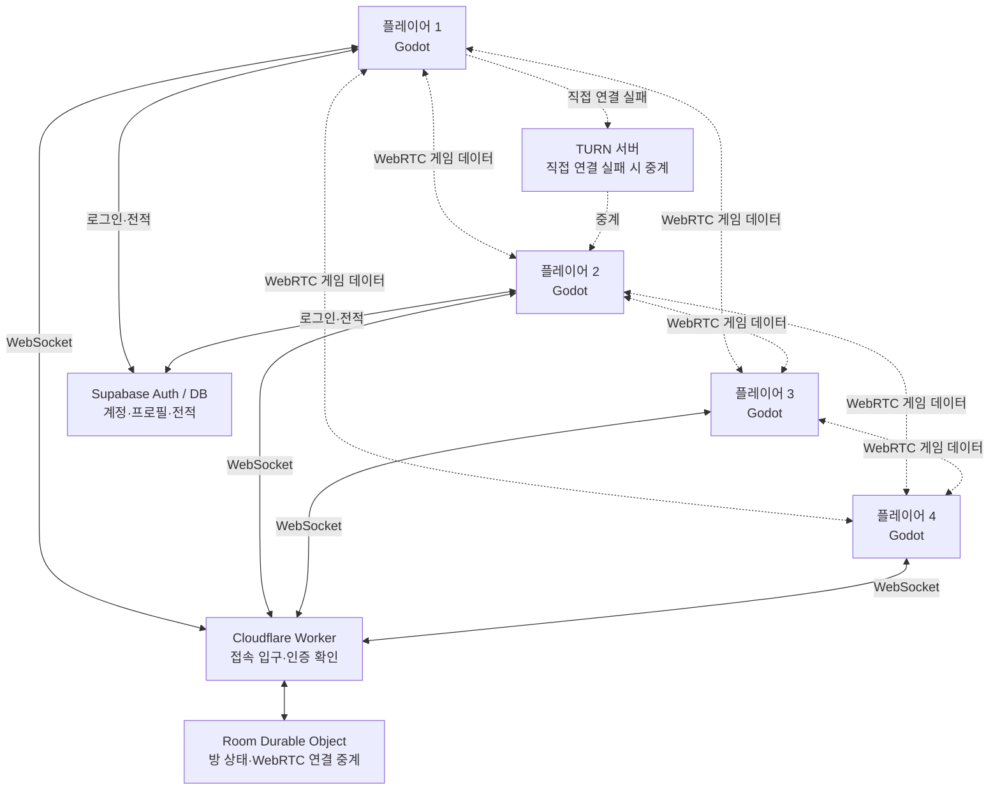

# Gfight 멀티플레이 구조 계획

> 이 문서는 멀티플레이를 구현하면서 계속 갱신하는 기준 문서다.  
> 코드에 실제로 반영된 내용과 논의 중인 내용을 혼동하지 않도록 상태를 구분한다.

## 상태 표기

- **확정**: 현재 구현 방향으로 합의한 내용
- **제안**: 유력하지만 아직 최종 확정하지 않은 내용
- **구현됨**: 코드에 반영된 내용
- **검증됨**: 실제 실행 또는 여러 PC 테스트까지 마친 내용

## 1. 목표

- Windows용 Godot 게임을 먼저 만든다. 웹 버전은 나중에 고려한다. **확정**
- 최대 4명이 한 방에서 대전할 수 있게 한다. **확정**
- 지인끼리 즐기는 게임을 우선하므로 강한 치트 방지는 초기 목표에서 제외한다. **확정**
- 최종 전송 방식은 WebRTC P2P를 목표로 한다. **확정**
- 계정, 전적, 승률 같은 영구 정보는 Supabase에 저장한다. **확정**
- 격투게임에 맞게 최종적으로 롤백 넷코드를 적용한다. **방향 확정, 세부 수치는 제안**

## 2. 현재 코드 상태

현재 Gfight의 멀티플레이 코드는 `ENetMultiplayerPeer`를 사용하는 호스트 권한 방식이다.

- 방장이 ENet 서버를 연다.
- 참가자는 방장의 주소로 접속한다.
- 방장 컴퓨터가 게임의 주 계산을 담당한다.
- 참가자는 입력을 보내고 방장은 계산 결과를 전달한다.

이 구조는 현재 코드의 출발점일 뿐, 아래의 WebRTC 구조가 이미 구현됐다는 뜻은 아니다.

## 3. 목표 구조



Cloudflare는 게임을 매 틱 계산하는 게임 서버가 아니다. 방과 접속을 관리하고, 플레이어끼리 WebRTC 연결을 만들 때 필요한 정보를 전달한다. 연결이 끝난 뒤 실제 게임 입력은 가능한 한 플레이어끼리 직접 주고받는다.

## 4. 각 구성 요소의 책임

| 구성 요소 | 담당하는 것 | 담당하지 않는 것 |
|---|---|---|
| Godot 클라이언트 | 입력 수집, 게임 시뮬레이션, 롤백, 화면 표시 | 계정 영구 저장 |
| Supabase Auth | 로그인, 사용자 ID, 로그인 토큰 | 실시간 게임 패킷 중계 |
| Supabase Database | 프로필, 승패, 승률, 경기 기록 | 틱 단위 게임 계산 |
| Cloudflare Worker | WebSocket 접속 입구, 토큰 확인, 방 찾기 | 캐릭터 이동·공격 계산 |
| Room Durable Object | 방 참가자, 준비 상태, 캐릭터 선택, WebRTC 시그널 전달 | 입력·스냅샷·롤백 패킷 처리 |
| WebRTC DataChannel | 입력, 확인 응답, 상태 해시 등 실제 게임 통신 | 영구 데이터 저장 |
| TURN 서버 | P2P 직접 연결이 막힌 경우 패킷 중계 | 방 규칙이나 게임 판정 |

Windows 네이티브 Godot에서 WebRTC를 사용할 때는 Godot용 WebRTC 네이티브 확장 설치가 필요하다.

## 5. 방 안에서 주고받을 정보

### Cloudflare 방 서버를 거치는 정보

- 임시 연결 ID 또는 로그인한 사용자 ID
- 표시 이름
- 방 생성, 참가, 퇴장
- 방장 ID
- 준비 상태
- 캐릭터 및 팀 선택
- 맵과 게임 설정
- WebRTC offer, answer, ICE candidate
- 각 플레이어의 연결 완료 상태
- 경기 시작용 `match_id`
- 경기 종료 결과 전달

방 상태에는 변경 번호인 `revision`을 둔다. 이전 상태보다 낮은 번호의 메시지를 받으면 무시하여, 늦게 도착한 정보가 최신 상태를 덮지 않게 한다.

### WebRTC로 직접 주고받을 정보

- 플레이어 입력과 그 입력의 틱 번호
- 최근 입력 묶음
- 상대가 어디까지 입력을 받았는지 나타내는 확인 정보
- 게임 상태가 같은지 확인하기 위한 상태 해시
- 필요할 경우 재동기화 정보

### 방 서버가 받으면 거절할 게임 정보

- 매 틱 입력 패킷
- 위치·속도 스냅샷
- 공격 판정과 피격 판정
- 롤백용 전체 게임 상태

이 구분을 지켜야 Cloudflare가 게임 트래픽을 모두 떠안지 않고, 방 서버와 게임 통신이 서로 독립적으로 유지된다.

## 6. P2P 연결 모양

최대 4명 모두가 서로 직접 연결하는 **풀 메시(full mesh)** 구조가 현재 제안이다.

```text
P1 ─ P2
│ ╲ ╱ │
│ ╱ ╲ │
P3 ─ P4
```

4명일 때 연결은 총 6개다. 인원이 적어서 관리 가능한 수이고, 특정 방장 한 명을 통신 중계점으로 삼지 않아도 된다.

다만 다음 항목은 아직 최종 확정이 필요하다.

- 처음부터 4인 풀 메시로 만들지, 먼저 2인 연결을 완성한 뒤 확장할지
- 경기 도중 한 명의 연결이 끊겼을 때의 처리
- 방장이 나갔을 때 방장을 넘길지 방을 닫을지
- 직접 연결 실패에 대비한 TURN을 언제 추가할지

## 7. 롤백의 기본 원리

각 입력에는 도착 시간이 아니라 게임의 **틱 번호**를 붙인다.

```text
현재 105틱 패킷
├─ 102틱 입력
├─ 103틱 입력
├─ 104틱 입력
└─ 105틱 입력
```

상대 입력이 아직 도착하지 않았으면 단순한 규칙으로 예측해서 게임을 계속 진행한다. 실제 입력이 나중에 도착해 예측과 다르면, 해당 틱의 저장 상태로 돌아가 실제 입력으로 현재까지 다시 계산한다.

받는 시각이 플레이어마다 달라도 같은 결과를 만들려면 다음 조건이 필요하다.

- 모든 입력에 틱 번호가 있어야 한다.
- 같은 상태와 같은 입력이면 항상 같은 결과가 나와야 한다.
- 최근 여러 틱의 게임 상태를 저장해야 한다.
- 게임 규칙 계산과 화면 효과를 분리해야 한다.
- 다시 계산할 때 소리나 이펙트가 중복 실행되지 않아야 한다.

### 첫 롤백 규칙 제안

아래 수치는 시작점일 뿐, 플레이 테스트 후 조정한다.

- 고정 시뮬레이션: 60틱/초
- 입력 지연: 2틱
- 이동 방향: 마지막으로 확인한 방향을 유지한다고 예측
- 점프·공격: 입력되지 않았다고 예측
- 패킷 하나에 최근 8틱 입력을 함께 전송
- 최대 롤백: 12틱
- 상태 저장: 최소 15틱
- 최대 범위를 넘긴 입력: 억지로 예측하지 않고 잠시 기다림

처음에는 이처럼 기계적인 예측으로 구현하고, 실제 테스트 자료를 본 뒤 예측과 지연 조절 수준을 높인다.

## 8. 구현 단계 제안

한 번에 롤백까지 만들지 않고, 각 단계가 작동하는지 확인하면서 진행한다.

1. Cloudflare 서버 저장소와 기본 실행 환경 만들기
2. 상태 확인 주소와 WebSocket 접속 만들기
3. 임시 플레이어 ID로 방 생성·참가·퇴장 만들기
4. 준비 상태와 캐릭터 선택 등 방 상태 동기화하기
5. 두 Godot 클라이언트 사이에 WebRTC DataChannel 열기
6. P2P로 간단한 테스트 메시지와 틱 입력 보내기
7. 기존 호스트 권한 게임을 WebRTC 위에서 한 판 실행하기
8. Supabase 로그인과 영구 사용자 ID 연결하기
9. 경기 결과와 승패 저장하기
10. 3~4인 풀 메시 연결로 확장하기
11. TURN 연결을 추가하기
12. 게임 시뮬레이션을 롤백 가능한 구조로 분리하기
13. 예측·상태 저장·되감기·재실행을 붙이기

### 첫 번째 완성 기준

첫 멀티플레이 세로 조각은 다음까지를 목표로 한다.

- Windows PC 두 대에서 같은 방에 들어간다.
- 두 플레이어의 준비 상태가 같이 보인다.
- WebRTC DataChannel이 직접 연결된다.
- 양쪽이 틱 번호가 붙은 입력을 주고받는다.
- 한 판을 시작하고 종료한 뒤 로비로 돌아온다.

이 단계에서는 정교한 롤백, 4인 연결, TURN, 랭킹을 필수 조건으로 삼지 않는다.

## 9. 아직 결정해야 할 항목

- 첫 버전도 로그인을 필수로 할지, 손님 접속을 허용할지
- 최초 게임 권한을 방장에게 둘지, 곧바로 완전한 롤백 동기화로 갈지
- 방장 퇴장과 경기 중 연결 해제 규칙
- 재접속 허용 시간
- 방 공개 여부와 방 코드 길이
- 승패 결과가 서로 다르게 보고됐을 때의 처리
- 상태 해시에 포함할 정확한 게임 데이터
- 롤백 세부 수치
- TURN 제공자와 무료 사용 한도

## 10. 작업 규칙

- 구현 전에 이 문서에서 해당 항목을 **확정**으로 바꾼다.
- 코드가 생기면 관련 파일과 메시지 형식을 문서에 기록한다.
- 실행만 됐으면 **구현됨**, 실제 여러 PC에서 확인했으면 **검증됨**으로 적는다.
- Cloudflare 방 서버에는 게임 입력 처리 기능을 섞지 않는다.
- 계정·전적과 실시간 방·게임 통신을 서로 분리한다.

## 11. 결정 기록

| 날짜 | 결정 | 상태 |
|---|---|---|
| 2026-11-05 | 첫 지원 환경은 Windows 네이티브로 한다. | 확정 |
| 2026-11-05 | 최대 인원은 4명으로 한다. | 확정 |
| 2026-11-05 | WebRTC P2P를 목표 통신 방식으로 사용한다. | 확정 |
| 2026-11-05 | 계정과 전적은 Supabase에 저장한다. | 확정 |
| 2026-11-05 | 롤백은 단순한 예측 규칙에서 시작해 개선한다. | 방향 확정 |
| 2026-11-05 | Cloudflare는 방과 시그널링을 맡고 게임 패킷은 처리하지 않는다. | 구조 제안 |
| 2026-11-05 | 최대 4인은 풀 메시로 연결한다. | 제안 |
